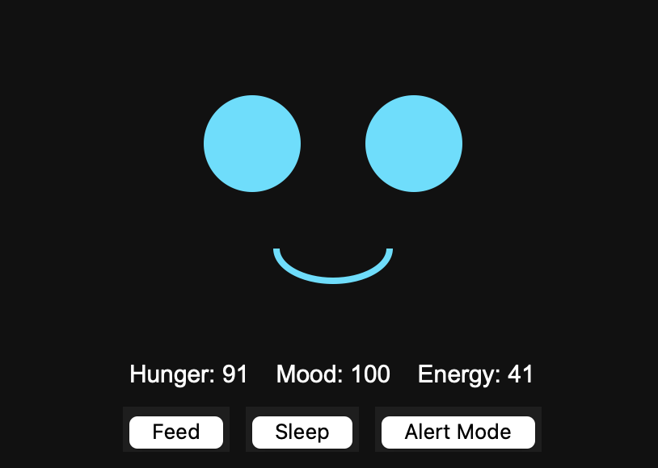
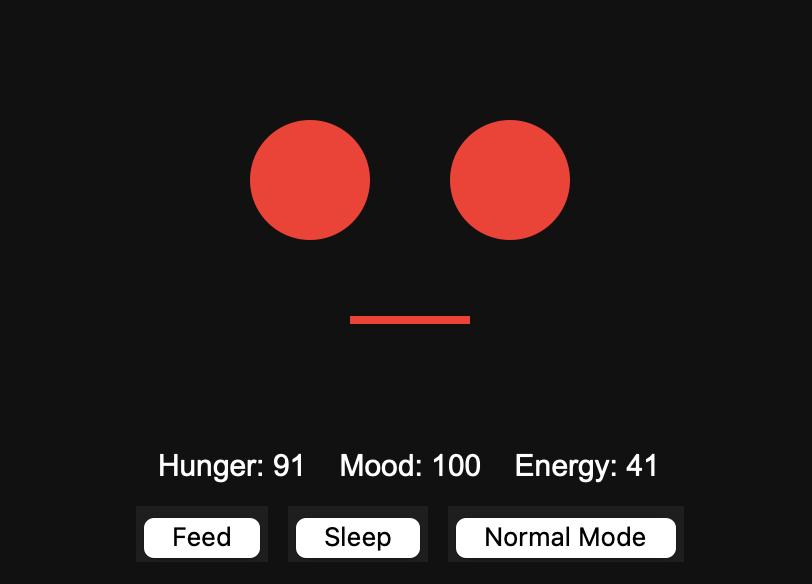

# Unit

A pocket AI companion that lives on your desktop. Unit has an animated face, moods that change over time, and a personality that switches between chaotic-cozy and mission-focused.

| Normal mode | Alert mode |
|---|---|
|  |  |

## What it does

- **Animated face** drawn with tkinter. It blinks, gets sleepy when energy is low, changes its mouth with its mood, and the eyes turn red in alert mode.
- **Stats that change over time:** hunger, mood and energy. They drop as you chat, and they keep dropping while you're away, so Unit notices when you've been gone.
- **AI-rated mood:** after each reply, the model rates how your message made Unit feel, and mood moves up or down.
- **Two personalities:** a silly, hyperactive default and a serious, clipped alert mode.
- **Reminders and tasks:** ask Unit to remind you of something, or use the commands below. Tasks are saved between sessions, and Unit alerts you when one is due.
- **Feed and Sleep buttons** to look after Unit.

## Commands

| Type this | What happens |
|---|---|
| `remind 15 take out the trash` | Sets a reminder for 15 minutes from now |
| `tasks` | Lists active reminders |
| `clear tasks` | Wipes all reminders |

You can also just ask in plain language, like "remind me to stretch in 30 minutes."

## Built with

- Python 3
- tkinter (GUI)
- Anthropic API
- python-dotenv

## Setup

1. Clone the repo and open the folder.
2. Install the dependencies:
   ```
   pip install -r requirements.txt
   ```
3. Create a file named `.env` in the project folder with your own Anthropic API key:
   ```
   ANTHROPIC_API_KEY=your-key-here
   ```
   The key stays on your machine. `.env` is listed in `.gitignore`, so it never gets uploaded.
4. Run it:
   ```
   python companion_gui.py
   ```

## Roadmap

- Move Unit to a Raspberry Pi with an LCD face
- Voice: text-to-speech and voice commands
- A phone app version

## Notes

Unit saves its stats and tasks to local JSON files next to the script. They are listed in `.gitignore`, so your personal data never goes to GitHub.
